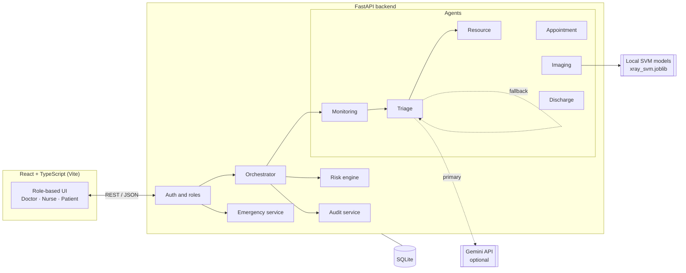
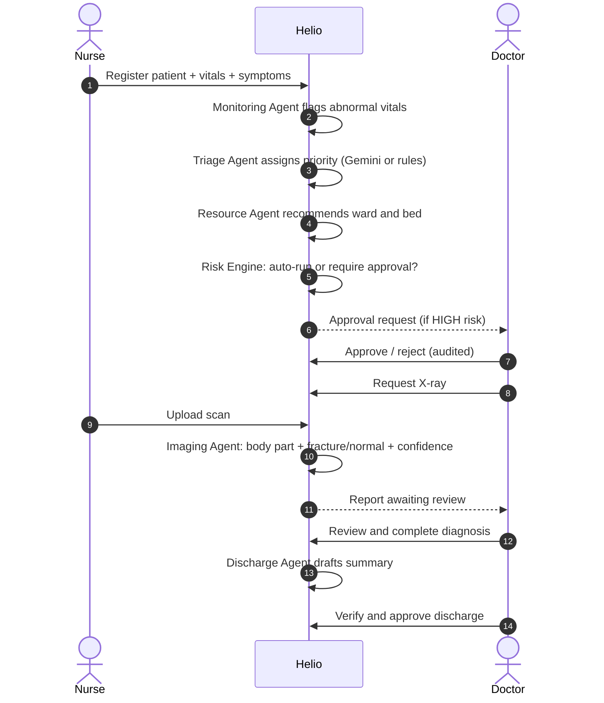
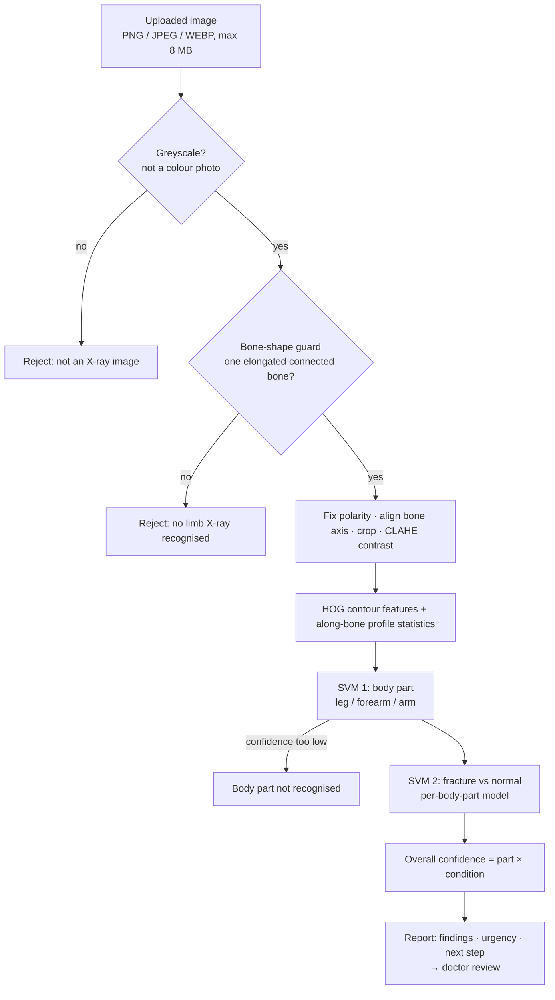

<div align="center">

# 🏥 Helio

### A governed multi-agent platform that coordinates hospital care from arrival to discharge

*Agents recommend. Doctors decide. Every action is logged.*


</div>

> ⚠️ **Helio is a research and demonstration prototype, not a medical device.** AI output is decision support only and must be reviewed by a qualified doctor or radiologist. See [Limitations](#-limitations-read-this).

---

## 📑 Table of contents

1. [Problem](#-problem)
2. [Solution](#-solution)
3. [How Helio differs from typical hospital workflows](#-how-helio-differs-from-typical-hospital-workflows)
4. [System architecture](#-system-architecture)
5. [Patient journey](#-patient-journey)
6. [The agents](#-the-agents)
7. [Governance layer](#-governance-layer)
8. [Emergency paging](#-emergency-paging)
9. [X-ray imaging agent](#-x-ray-imaging-agent)
10. [Roles and permissions](#-roles-and-permissions)
11. [Tech stack and why](#-tech-stack-and-why)
12. [Project structure](#-project-structure)
13. [Getting started](#-getting-started)
14. [API overview](#-api-overview)
15. [Testing](#-testing)
16. [Deployment](#-deployment)
17. [Limitations](#-limitations-read-this)
18. [Roadmap](#-roadmap)
19. [FAQ](#-faq)
20. [Team](#-team)

---

## 🎯 Problem

Inside a hospital, several time-critical decisions are made one after another:

- **Who is seen first?** (triage)
- **Which ward and bed?** (resource allocation)
- **Which doctor?** (specialty matching)
- **Who is called in an emergency?** (paging)
- **Who reads the scan?** (imaging)
- **What goes into the discharge summary?**

In many hospitals each of these lives in a different system, is handed off by phone, paper or memory, and leaves little record of *why* the decision was made. The result is delayed care for the sickest patients, bed bottlenecks, and no clear trail when something goes wrong.

## 💡 Solution

Helio is a **coordination layer**. Specialised agents each own one decision, an **orchestrator** passes the patient between them, a **risk engine** decides which actions may run automatically and which need a human, and an **audit log** records everything with a reason.

| Principle | What it means in Helio |
|---|---|
| **Human in the loop** | High-risk actions are gated behind approval. Doctors finalise diagnoses and discharges. |
| **Resilient** | Cloud AI is optional. A deterministic fallback keeps the workflow running if Gemini is down, slow or has no key. |
| **Explainable** | Every recommendation includes a reason and a confidence. |
| **Auditable** | Every agent action is stored with agent, action, status and details. |
| **Honest** | The system refuses inputs it can't handle and labels demo output clearly. It never invents a result. |

---

## 🔍 How Helio differs from typical hospital workflows

Hospitals vary, so this compares Helio with the *common* pattern rather than any one hospital.

| | Typical hospital | Helio |
|---|---|---|
| **Systems** | Registration, beds, EMR, imaging and billing run separately with manual handoffs | One connected flow with defined agent handoffs |
| **Role of software** | Mostly records and routes information | Recommends the next step (priority, bed, doctor, specialist) |
| **AI oversight** | Usually none, or opaque | Risk engine gates high-risk actions for human approval |
| **Decision trail** | Clinical notes and order logs | Per-action audit log including *which agent* and *why* |
| **If AI fails** | Not applicable | Automatic rule-based fallback |
| **Emergency alert** | Overhead page or phone calls | Specialty-ordered paging with an on-screen siren until acknowledged |

**Where established hospital systems are stronger:** they are validated, certified, integrated with pharmacy, lab and billing, and use standards such as HL7/FHIR, DICOM and PACS. Some already use regulator-cleared medical AI trained on large real datasets. Helio is a prototype of the *coordination* idea, not a replacement for those systems.

---

## 🏗 System architecture



**Single deployable unit.** A multi-stage Docker build compiles the React app and serves it from FastAPI, so one container runs everything.

## 🧭 Patient journey



---

## 🤖 The agents

| Agent | Method | Input → Output | Notes |
|---|---|---|---|
| **Monitoring** | Deterministic rules (no LLM) | Heart rate, SpO₂, temperature → `NORMAL` / `WARNING` / `CRITICAL` + abnormal signals | Objective baseline the other agents are checked against |
| **Triage** | Gemini, with rule-based fallback | Patient + monitoring result → `LOW` / `MEDIUM` / `HIGH` / `CRITICAL`, reasoning, confidence | Confidence is **calibrated**: reduced when data is missing and capped when it contradicts the Monitoring Agent |
| **Resource** | Rules | Priority → required ward (ICU / General Medicine / ER), bed, approval flag | Alternate-ward admission requires approval |
| **Appointment** | Rule-based symptom scoring | Symptoms → specialty → *available* doctors in the database | Never maps a symptom to a named doctor directly |
| **Imaging** | Two local SVMs | X-ray → body part, fracture/normal, confidence, urgency, next step | See [X-ray imaging agent](#-x-ray-imaging-agent) |
| **Discharge** | Rules + templates | Patient record → draft summary | Draft only, doctor verifies. Amount is set separately |
| **Emergency service** | Rules | Emergency type → ordered specialties → up to 3 most experienced available doctors | Falls through to the next specialty if none is free |

**Monitoring thresholds (examples):** HR < 50 or > 120, SpO₂ < 94% (critical below 90%), temperature ≥ 38 °C (high at ≥ 39 °C).

**Why a hybrid approach?** A language model is good at reasoning over free-text symptoms, but its self-reported confidence is unreliable and it can fail or time out. Helio keeps a deterministic layer underneath it: the rules provide the safety floor, and the LLM adds nuance on top.

---

## 🛡 Governance layer

The **Risk Engine** classifies every proposed action before it runs.

| Risk | Approval | Example actions |
|---|---|---|
| **LOW** | Automatic | Routine booking, notifications, queue reorder, status refresh, routine diagnostic slot |
| **HIGH** | **Human approval required** | Bed reassignment, alternate-ward admission, emergency re-prioritisation, discharge approval, major schedule disruption, critical prioritisation change |
| **Unknown action** | **Human approval required** | Anything not on the lists is gated by default (fail-safe) |

The **Audit Log** records `patient · agent · action · status · details · timestamp` for every agent action and is viewable in the Audit page. Nurse vitals updates, emergency alerts and approvals are all audited.

---

## 🚨 Emergency paging

1. A **nurse** presses the red **Emergency** button and picks a type (road accident / major trauma, cardiac arrest, stroke / head injury, severe breathing difficulty, severe bleeding, major burns, fractures / spine injury, other).
2. Each type maps to an **ordered list of specialties** (for example road accident → Emergency & Urgent Care → Orthopaedics → Critical Care).
3. The first specialty with an available doctor wins, and the **3 most experienced available doctors** are paged. If none is free, the next specialty is tried.
4. Paged doctors get a **full-screen red alert with a siren** (Web Audio, no audio file) on whatever page they are on. It repeats until they press **I'm responding**.
5. The nurse sees who responded and can cancel a false alarm. Everything is audited.

---

## 🩻 X-ray imaging agent



**Design points**
- **Runs locally.** No scan is sent to an outside API.
- **Same code for training and inference.** `app/ml/xray_features.py` is shared, so there is no train/serve drift.
- **Guard before the model.** An SVM always returns *some* answer, even for input unlike its training data. The shape guard rejects noise, gradients, blank frames and colour photos first.
- **Calibrated probabilities**, not raw margins, feed the confidence score.
- **Fails safe.** A missing model, an unrecognised image or low confidence all route to manual review. No result is ever made up.

### ⚠️ About the model in this repository

> **The bundled `xray_svm.joblib` is a demo model trained on computer-generated (synthetic) limb images, not real patient X-rays.**
>
> - It covers **leg, forearm and arm** and is **not clinically validated**.
> - Every report is labelled **DEMO MODEL**, confidence is capped at **55%**, and a doctor review is always requested.
> - Its near-perfect accuracy is on synthetic images only and says nothing about real X-rays. It can call an intact bone a fracture.
> - DICOM (`.dcm`) is not read directly. Export as PNG, JPEG or WEBP.

**Train on real data**

```bash
# Folder layout: <body_part>/<normal|fracture>/*.png   (e.g. from MURA or a Kaggle bone-fracture set)
cd backend
python train_xray_svm.py --data /path/to/dataset
```

The demo label and confidence cap switch off automatically, and real held-out accuracy appears on reports.

**Rebuild the demo model** (about 10 minutes on one CPU)

```bash
cd backend
python make_demo_xray_data.py --out demo_xray_data
python train_xray_svm.py --data demo_xray_data --synthetic-demo
```

Keep `scikit-learn==1.8.0` and `scikit-image==0.26.0` pinned so the saved model loads on the server.

---

## 👥 Roles and permissions

| Capability | Doctor | Nurse | Patient |
|---|:---:|:---:|:---:|
| View patients, triage and bed recommendations | ✅ | ✅ | own record |
| Register patients / update vitals | | ✅ | |
| Approve or reject gated actions | ✅ | | |
| Request diagnostics | ✅ | | |
| Upload scans | | ✅ | |
| Review and finalise diagnosis | ✅ | | |
| Sound emergency alarm | | ✅ | |
| Receive emergency siren and acknowledge | ✅ | | |
| Mark appointment as visited | | ✅ | |
| Approve discharge | ✅ | | |
| Self-register and view own portal | | | ✅ |

Passwords are stored hashed (PBKDF2).

---

## 🧰 Tech stack and why

| Layer | Choice | Why |
|---|---|---|
| Backend | **FastAPI** + Pydantic | Fast to build, typed request validation, automatic OpenAPI docs, best-in-class Python ML ecosystem |
| ORM / DB | **SQLAlchemy** + **SQLite** | Zero-setup demo database; the ORM allows a straight move to PostgreSQL |
| Frontend | **React 19**, **TypeScript**, **Vite**, **Recharts** | Typed UI, fast builds, role-specific pages and live charts |
| LLM | **Gemini** (optional) | Free tier for reasoning over free-text symptoms; never a hard dependency |
| Imaging ML | **scikit-learn SVM** on **HOG** + profile features | Works on small datasets, runs on a free CPU, explainable features |
| Image processing | scikit-image, SciPy, Pillow, NumPy | Alignment, contrast enhancement, feature extraction |
| Packaging | **Docker** multi-stage, **Render** blueprint | One-click deployment of a single container |

---

## 📁 Project structure

```
Helio/
├── backend/
│   ├── app/
│   │   ├── agents/          # monitoring, triage, resource, appointment, imaging, discharge
│   │   ├── governance/      # risk_engine.py
│   │   ├── services/        # orchestrator, emergency, audit, triage, appointment services
│   │   ├── ml/              # xray_features.py (shared) + xray_svm.joblib
│   │   ├── models/          # SQLAlchemy models (patient, doctor, nurse, bed, appointment, ...)
│   │   ├── schemas/         # Pydantic schemas
│   │   ├── database/        # connection, init, seed, CSV seed data
│   │   ├── core/            # config, security, clock, staff
│   │   └── main.py          # FastAPI app and routes
│   ├── train_xray_svm.py    # train the two SVMs from a folder of images
│   ├── make_demo_xray_data.py
│   ├── test_*.py            # unit tests
│   ├── requirements.txt
│   └── run.py
├── frontend/
│   └── src/
│       ├── pages/           # Dashboard, Beds, Appointments, Diagnostics, Discharge, Audit, ...
│       └── components/      # EmergencyDoctor/Nurse, BedDecisionDialog, CommandPalette, ...
├── Dockerfile
├── render.yaml
└── DEPLOY.md
```

---

## 🚀 Getting started

### Prerequisites
- Python 3.11+
- Node.js 20+

### 1. Backend
```bash
cd backend
pip install -r requirements.txt
cp .env.example .env        # optional: add your Gemini key
python run.py
```

### 2. Frontend
```bash
cd frontend
npm ci
npm run dev
```

### Environment variables

| Variable | Required | Purpose |
|---|:---:|---|
| `GEMINI_API_KEY` | no | Enables Gemini triage. Without it, the rule-based fallback runs. [Free key](https://aistudio.google.com/apikey) |
| `GEMINI_MODEL` | no | Defaults to `gemini-2.5-flash` |
| `APPOINTMENT_GRACE_MINUTES` | no | Delay before an overdue appointment becomes "Not visited" (default `0`) |

### Demo accounts

Password for all: `123`

| Email | Role | Specialty |
|---|---|---|
| tharshini@gmail.com | Doctor | Emergency & Urgent Care |
| eva@gmail.com | Doctor | Cardiology |
| tahseen@gmail.com | Nurse | |
| hawwa@gmail.com | Nurse | |

On a fresh database Helio seeds **500 patients** and **110 staff (38 doctors, 72 nurses)** from `backend/app/database/data/`. Patients can also self-register from the sign-in page.

### Suggested demo path (about 5 minutes)

1. Sign in as a **nurse**, register a patient with vitals and symptoms.
2. Open the patient: see monitoring signals, triage priority with confidence, and the bed recommendation.
3. Sign in as a **doctor**, approve any gated action, then request an **X-ray**.
4. As the **nurse**, upload an image and see the AI report appear, then upload a non-X-ray to see the safe rejection.
5. As the **doctor**, review and complete the diagnosis.
6. Press **Emergency** as a nurse and watch the doctor's siren alert.
7. Open the **Audit** page and see every step recorded.

---

## 🔌 API overview

Interactive docs are available at `/docs` (Swagger) when the backend is running. About 56 endpoints; the main groups:

| Group | Examples |
|---|---|
| **Auth** | `POST /api/auth/login` · `POST /api/auth/patient-login` · `POST /api/auth/patient-register` |
| **Patients** | `GET/POST /api/patients` · `PATCH /api/patients/{id}/vitals` · `POST /api/patients/{id}/assign-doctor/{doctor_id}` |
| **Agents** | `GET /api/monitoring/patient/{id}` · `GET /api/triage/patient/{id}` · `GET /api/resource/patient/{id}` · `GET /api/helio/patient/{id}` (combined run) |
| **Beds** | `GET /api/beds` · `POST /api/resource/allocate/{id}` · `POST /api/resource/reject/{id}` · `POST /api/appointments/{id}/bed-decision` |
| **Appointments** | `GET /api/appointments/recommend/{patient_id}` · `POST /api/appointments` · `PATCH /api/appointments/{id}/visited` |
| **Diagnostics** | `POST /api/diagnostics` · `POST /api/diagnostics/{id}/image` · `PATCH /api/diagnostics/{id}/status` |
| **Discharge** | `POST /api/discharges/draft/{patient_id}` · `PATCH /api/discharges/{id}/approve` · `PATCH /api/discharges/{id}/reject` |
| **Emergency** | `POST /api/emergency/alerts` · `GET /api/emergency/alerts/mine` · `PATCH /api/emergency/alerts/{id}/acknowledge` |
| **Ops** | `GET /api/audit` · `GET /api/stats` · `GET /health` |

---

## ✅ Testing

```bash
cd backend
pytest
```

| Test file | Covers |
|---|---|
| `test_risk_engine.py` | Gated vs automatic action classification |
| `test_triage.py`, `test_triage_fallback.py`, `test_triage_service.py` | Gemini path, rule-based fallback, calibration |
| `test_resource_agent.py` | Ward and bed matching |
| `test_workflow_changes.py` | End-to-end workflow rules |
| `test_imaging_agent.py` | Imaging agent behaviour and the bone-shape guard |

---

## ☁️ Deployment

Helio deploys to **Render** from the included `Dockerfile` and `render.yaml`:

1. Push the repository to GitHub (do **not** commit `.env`).
2. Render dashboard → **New +** → **Blueprint** → select the repo → **Apply**.
3. Optionally set `GEMINI_API_KEY` in Render → Environment.

On Render's free plan the disk is ephemeral, so the SQLite database is re-created and re-seeded on every deploy or restart, and the service sleeps when idle (open `/health` a few minutes before a demo). See [DEPLOY.md](DEPLOY.md) for details.

---

## ⚠ Limitations (read this)

- **Prototype only.** Not validated for clinical use and must not be used for real patient care.
- **Demo X-ray model.** Trained on synthetic images; see [above](#️-about-the-model-in-this-repository).
- **Rule-based pieces are simplified.** Monitoring thresholds, ward matching and discharge medication suggestions are keyword and threshold rules, and medication text is a draft for a doctor to edit, not clinical advice.
- **Prototype-level security.** Hashed passwords and role checks exist, but there is no JWT, encryption at rest or formal compliance.
- **SQLite** is a demo database and not meant for hospital-scale load.
- **No standards integration** yet (HL7/FHIR, DICOM, PACS).

## 🗺 Roadmap

- [ ] Train imaging models on real, licensed datasets and report held-out performance
- [ ] Move to a CNN or transfer-learning model once data and GPU are available
- [ ] PostgreSQL and multi-instance deployment
- [ ] JWT authentication, encryption at rest, and fine-grained access control
- [ ] HL7/FHIR integration and DICOM support
- [ ] Clinical validation with practising doctors
- [ ] Compliance work before any real deployment (HIPAA, India's DPDP Act)

## ❓ FAQ

**Why SVM instead of a deep network?**
SVMs work with small datasets, run on a free CPU, and use inspectable features. A CNN is the planned upgrade once real data and a GPU are available.

**What happens if Gemini is down?**
The rule-based triage takes over automatically. Nothing in the workflow depends on the cloud.

**Does a scan leave the server?**
No. Imaging models run locally.

**Is the AI allowed to act on its own?**
Only for low-risk, routine actions. Anything that can affect another patient's care path requires human approval, and unknown actions are gated by default.

**Is the X-ray accuracy real?**
Not yet. The bundled model is a demo trained on synthetic images, and the app says so on every report.

---

## 👨‍💻 Team

| Name | Role / contribution |
|---|---|
| _Member 1_ | _e.g. Backend, agents and orchestrator_ |
| _Member 2_ | _e.g. Frontend and UX_ |
| _Member 3_ | _e.g. ML and imaging pipeline_ |
| _Member 4_ | _e.g. Governance, testing, deployment and docs_ |

## 📜 Disclaimer

Helio is a research and demonstration prototype. AI outputs are decision support only and must be reviewed by a qualified doctor or radiologist. It must not be used for real patient care.

## 📄 License

_Add a license (for example MIT) before publishing._
